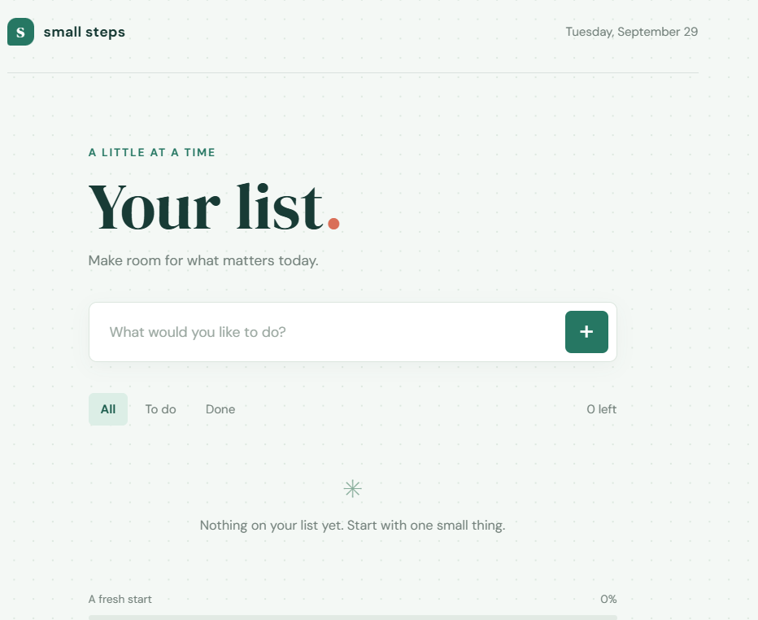

# Small Steps

Small Steps is a simple, responsive to-do list app for organizing daily tasks. Add items, mark them complete, filter the list by status, and track your progress. Tasks are saved in the browser so they remain available after a refresh.

## Features

- Add and delete tasks
- Mark tasks complete or active
- Filter tasks by all, to do, or done
- View completion progress and clear completed tasks
- Save tasks locally in the browser

## Live Demo

[Open Small Steps](https://rococo-froyo-c5f479.netlify.app/)

## Screenshots

